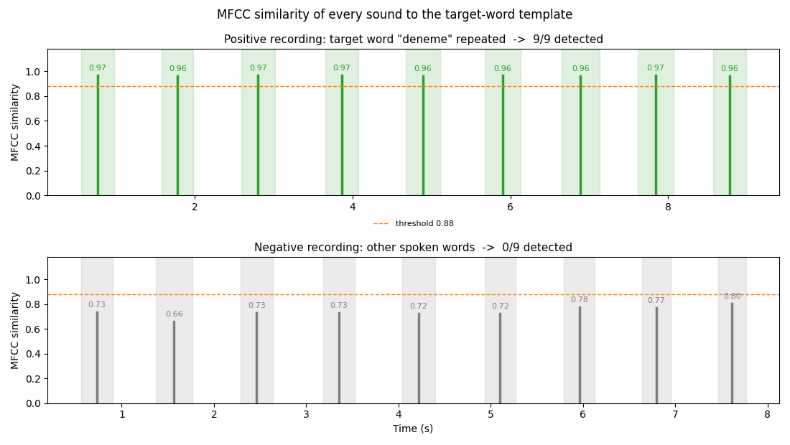
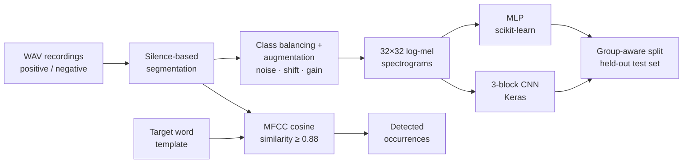

# Sound Event Detection: Keyword Spotting with Classical DSP and Neural Networks


Finds every occurrence of a spoken target word inside a longer recording — first with a
model-free MFCC template matcher, then with two compact classifiers (a scikit-learn MLP and a
Keras CNN) evaluated with a **leakage-safe, group-aware train / validation / test split**.



## Why this project

A personal learning project, built end to end on a dataset recorded with my own voice. The
notebook doubles as the write-up: every section explains *why* a step is done, not just *what*
the code does.

TODO(eray): one sentence on why you picked keyword spotting, and the month/year it was built.

## How it works



1. **Load & inspect** a recording of the target word: waveform, RMS volume, spectrogram.
2. **Segment** longer recordings into individual sounds with `librosa.effects.split`, then merge
   over-split pieces, re-split merged ones at their quietest point, and drop fragments that are
   too short to be speech.
3. **Build the dataset**: balance the classes, augment each clip (noise, time-shift, gain), and
   tag every augmented copy with the `group_id` of its source sound.
4. **Model-free detection**: compare every sound in a long recording to the target word with
   MFCC cosine similarity. An RMS-envelope cross-correlation curve is plotted for context, but the
   decision uses MFCCs, because volume shape alone matches almost any spoken word.
5. **Features**: every clip becomes a 32×32 log-mel spectrogram, shared by both models.
6. **Model A** — `MLPClassifier` (128-64-32) on the flattened spectrogram.
7. **Model B** — 3-block Conv2D/MaxPool CNN (56,129 parameters) on the 2-D spectrogram.
8. **Compare** both models on the same held-out test set.

## Key engineering decisions

- **Leakage-safe evaluation.** Augmented copies of one source sound would leak between train
  and test under a random split. `StratifiedGroupKFold` keeps every group on one side, and the
  notebook `assert`s that train, validation and test share no group.
- **Baseline before learning.** The MFCC matcher shows what is achievable with no training at all.
- **Threshold chosen from evidence.** A low-res mel-spectrogram similarity was tried first and
  rejected: it scored 0.6–0.8 for almost any two voiced sounds. MFCCs separate the same word
  (≈0.95–1.0) from a different word (< 0.85), so the threshold sits at 0.88.
- **Self-validating notebook.** Synthetic recordings with a known number of target words, and a
  440 Hz beep test that checks every stage (RMS, spectrogram, correlation, detector, classifier),
  fail loudly via `assert` if anything regresses.
- **Runs with zero setup.** If `data/` is empty, the notebook synthesizes audio so the whole
  pipeline still runs on a fresh clone.

## Results

| | Value |
|---|---|
| Source sounds | 18 (9 target, 9 non-target), ×4 augmentation → 72 clips |
| Split (group-disjoint) | 40 train / 16 validation / 16 test clips |
| Independent source sounds in the test set | **4** (2 per class) |
| MLP — validation / test accuracy | 1.000 / 1.000 |
| CNN — test accuracy | 1.000 |
| Detector on the positive recording | 9 / 9 occurrences found (scores 0.96–0.97) |
| Detector on the negative recording (9 other words) | 0 / 9 false positives (scores 0.66–0.80) |

TODO(eray): the last row and the figure at the top (`assets/detection_pos_neg.png`) were produced
by running `detect_occurrences` on the negative recording outside the notebook. Add that as a cell
in `sound_event_detection.ipynb` so both are reproducible, or remove them.

**How to read these numbers:** perfect accuracy on a test set built from only 4 independent
recordings of one speaker says the pipeline works, not that it generalises. The point of the
project is the methodology — the same split and checks would give an honest estimate on a larger
dataset.

<p>
  
  
  
</p>


## Quick start

Tested with **Python 3.12**.

```bash
python -m venv .venv
# Windows:
.venv\Scripts\activate
# macOS / Linux:
source .venv/bin/activate

pip install -r requirements.txt
jupyter notebook sound_event_detection.ipynb
```

Run all cells (about a minute on a CPU). TensorFlow is optional: without it the notebook skips
the CNN section and still runs — see the comments at the top of `requirements.txt`.

Headless run:

```bash
jupyter nbconvert --to notebook --execute sound_event_detection.ipynb --output executed.ipynb
```

## Data

All recordings are my own voice, recorded for this project, and are released with the code under
the MIT license.

| File | Contents |
|---|---|
| `data/deneme_sound.wav` | a single utterance of the target word **"deneme"** (the template) |
| `data/positive/multiple_deneme_sounds.wav` | the target word repeated (9 occurrences) |
| `data/negative/multiple_test_sounds.wav` | other spoken words (9 sounds), no target word |

To use your own word, replace these files (keep the folder layout). If the folders are empty,
the notebook generates a synthetic dataset instead.

## Project structure

```
.
├── sound_event_detection.ipynb   # full pipeline + write-up (the main artifact)
├── requirements.txt              # pinned dependencies + setup guide
├── data/
│   ├── deneme_sound.wav          # template recording of the target word
│   ├── positive/                 # recordings that contain the target word
│   └── negative/                 # recordings that do not
└── assets/                       # figures generated by the notebook, used in this README
```

## Limitations & future work

- **Tiny, single-speaker dataset.** 18 source sounds from one voice; test accuracy rests on 4 of
  them. More, and more varied, recordings (speakers, microphones, background noise) are the
  first thing needed for a reliable estimate.
- **Pre-segmented input.** Detection relies on silence-based segmentation, so it assumes words
  separated by pauses; continuous speech would need a sliding-window classifier instead.
- **Fixed threshold.** The 0.88 MFCC threshold was set by inspecting scores on this data, not
  tuned on a separate set.
- **Notebook-only code.** All logic lives in the notebook; there is no importable module or test
  suite outside it.

TODO(eray): anything you would do differently if you started again.

## About

Solo, self-directed learning project.

## Acknowledgments

- Jon Nordby, *"Sound Event Detection with Machine Learning"* — used as a general introduction to
  the sound-event-detection workflow.
- I used an AI assistant (Anthropic's Claude) during this project to help write and debug parts of
  the code, and reviewed the resulting code so that I can explain each step.

## License

[MIT](LICENSE) — code and recordings.
