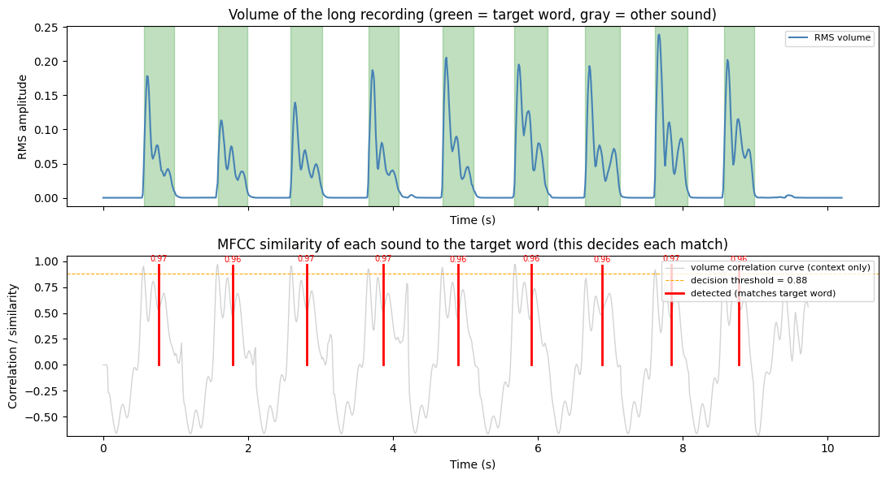
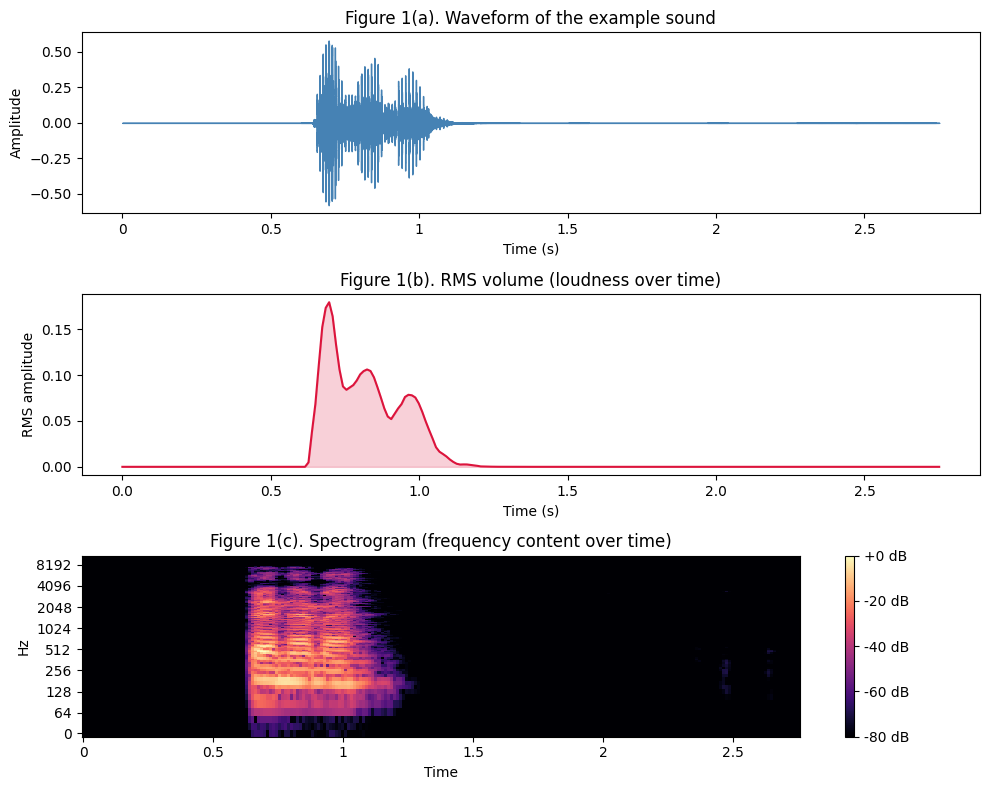
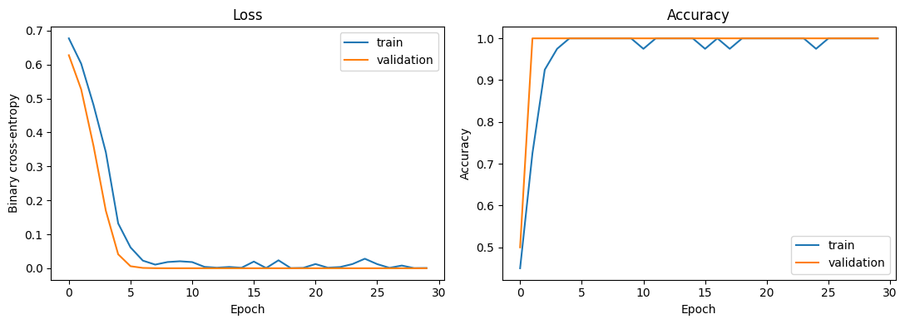
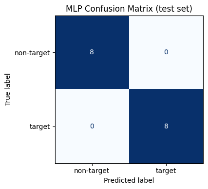
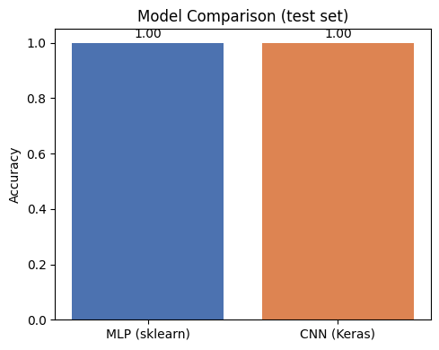

# Sound Event Detection: Keyword Spotting with Classical DSP and Neural Networks

Detects a single spoken target word inside longer audio recordings using a classical
signal-processing baseline (RMS/MFCC template matching) and two compact neural networks
(scikit-learn MLP and a Keras CNN) trained on low-resolution spectrograms.



## Overview

This project tackles *sound event detection* (a form of keyword spotting): given a short
recording of a target word, find every occurrence of that word inside a longer recording. It
walks through the full pipeline end to end — signal analysis, dataset construction, a
model-free detector, and two trained classifiers — and compares their results.

The notebook doubles as the project write-up: every section starts with a short explanation of
*why* a step is done, not just *what* the code does.

## Key highlights

- **Leakage-safe evaluation.** The dataset is built by segmenting a few source recordings and
  augmenting each clip (noise, time-shift, gain). A naive random split would let augmented
  copies of the same source clip land in both the training and test sets, inflating accuracy.
  This is avoided with `StratifiedGroupKFold`, grouping all copies of one source clip together
  so no group is ever split across sets.
- **Proper train / validation / test methodology.** Data is split into three group-disjoint,
  class-balanced sets: training (fits the weights), validation (monitors over-fitting and
  guides hyper-parameters), and a held-out test set (touched only once, at the end, for the
  final numbers).
- **An explained, not just observed, training curve.** Training accuracy comes in slightly
  below validation accuracy during CNN training — the notebook explains why: dropout is active
  during training but disabled at evaluation, which is expected, not a bug.
- **Two models compared head-to-head** on the same features and the same held-out test set: a
  scikit-learn `MLPClassifier` on flattened spectrograms vs. a 3-block Keras CNN that keeps the
  2-D time/frequency structure.
- **A model-free baseline first.** Before any learning happens, a simple RMS/MFCC template-matching
  detector establishes what's achievable without training a model at all — useful context for
  judging whether the learned models are pulling their weight.
- **Self-validating pipeline.** The notebook includes its own test suite: synthetic recordings
  with a known number of target-word occurrences are fed through the detector, and `assert`
  statements fail loudly if the count is ever wrong. A second suite validates every stage
  (RMS, spectrogram, correlation, detector, neural net) against a synthetic 440 Hz tone with a
  known ground truth.
- **Runs with zero setup.** If `data/` is empty, the notebook generates its own synthetic audio
  so the entire pipeline — including training — still runs start to finish on a fresh clone.

## Results

| Metric | Value |
|---|---|
| Dataset split | 40 train / 16 validation / 16 test clips (group-disjoint) |
| MLP — validation accuracy | 1.000 |
| MLP — test accuracy | 1.000 |
| CNN — test accuracy | 1.000 |
| Target-word detections | 9 / 9 correctly located in the longer recording |

*(The dataset is intentionally small, so these numbers are optimistic rather than a claim of a
production-ready system — see [Limitations](#limitations).)*









## Methodology

1. **Load & inspect** a recording of the target word; visualize its waveform, RMS volume, and
   spectrogram.
2. **Build a dataset** by segmenting several recordings into individual word/non-word clips,
   balancing classes, and augmenting (noise, time-shift, gain) while tracking a `group_id` per
   source clip.
3. **Model-free detection**: slide the target word's RMS envelope across a longer recording as
   a first pass, then confirm each candidate using MFCC cosine similarity (which captures
   frequency "colour" rather than loudness, so it rejects a different word even if its volume
   shape looks similar).
4. **Feature extraction**: convert every clip into a 32×32 log-mel spectrogram, shared by both
   models.
5. **Train Model A** — a scikit-learn `MLPClassifier` on the flattened spectrogram.
6. **Train Model B** — a 3-block Keras CNN on the 2-D spectrogram.
7. **Compare** both models on the same held-out test set.

## Tech stack

Python · [librosa](https://librosa.org/) (audio I/O, RMS, STFT, MFCC, mel-spectrograms) ·
[scikit-learn](https://scikit-learn.org/) (MLP, `StratifiedGroupKFold`, scaling, metrics) ·
[TensorFlow / Keras](https://www.tensorflow.org/) (CNN) · NumPy · SciPy · Matplotlib

## Project structure

```
.
├── sound_event_detection.ipynb   # full pipeline + write-up (the main artifact)
├── requirements.txt              # pinned dependencies + setup guide
├── data/
│   ├── deneme_sound.wav          # single recording of the target word (template)
│   ├── positive/                 # recordings that contain the target word
│   └── negative/                 # recordings that do not
└── assets/                       # figures generated by the notebook, used in this README
```

## Setup

```bash
python -m venv .venv
# Windows:
.venv\Scripts\activate
# macOS / Linux:
source .venv/bin/activate

pip install -r requirements.txt
jupyter notebook
```

Then open `sound_event_detection.ipynb` and run all cells. Full details (including a
TensorFlow-optional fallback) are in the comments at the top of `requirements.txt`.

If `data/` is empty, the notebook synthesizes its own audio and the whole pipeline — including
training — still runs end to end.

## Limitations

- The dataset is small (a handful of short recordings, segmented, balanced, and lightly
  augmented), so the reported accuracy is likely optimistic. More, and more varied, recordings
  would give a more reliable estimate.
- The MLP treats the spectrogram as a flat vector, while the CNN uses its 2-D structure, which
  is usually the more appropriate inductive bias for this kind of data.
- The volume-based template matching is fast and easy to interpret but sensitive to loudness
  and timing, so it's used alongside the trained models rather than as a replacement for them.

## Acknowledgments

- Jon Nordby, *"Sound Event Detection with Machine Learning"* — used as a general introduction
  to the sound-event-detection workflow.
- I used an AI assistant (Anthropic's Claude) during this project to help write and debug parts
  of the code, and reviewed the resulting code so that I can explain each step.

## License

[MIT](LICENSE)
